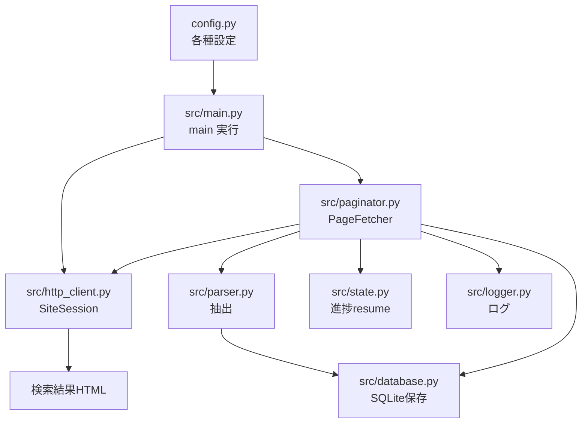
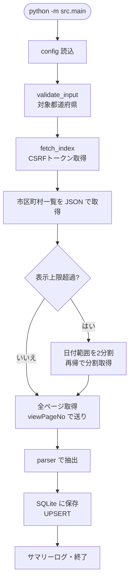

# Beginner Overview — webScraping 初心者・中級者向け解説

このドキュメントは、`webScraping`（法人番号公表サイトのスクレイパ）をこれから読む人に向けて書かれています。
Python **初級者** の方は「1〜4章」、**中級者** の方は「5章」を重点的に読むと効率的です。

---

## 1. プロジェクト全体構造と役割

### 1.1 このプロジェクトは何をするのか

**webScraping** は、国税庁法人番号公表サイトから「法人の公開基本3情報（法人番号・名称・所在地）」を
都道府県単位で取得し、SQLite に保存するスクレイパ（自動収集プログラム）です。

- 対象サイト: `https://www.houjin-bangou.nta.go.jp/`（全国の法人が登録されている公的なサイト）
- コマンド1つで対象都道府県の全市区町村を巡回
- 1地区が50,000件を超える場合は「法人番号指定年月日」で**期間を自動分割**して完全取得
- 途中で落ちても `state/progress.json` から**再開**できる
- 結果は SQLite（`data/houjin.sqlite`）に保存され、失敗した取得はログとDBに残る

**使える場面**:
- 特定エリアの企業リストを一括で取得したい
- 社名・所在地のデータベースを構築したい
- 市区町村ごとの法人分布を分析したい

### 1.2 フォルダ構成

```
webScraping/
├── AGENTS.md               ← 開発者向けプロジェクトガイド（最初に読む）
├── config.py               ← 全設定値とCSSセレクタの集約（ルート）
├── requirements.txt        ← 依存パッケージ一覧
├── pyproject.toml          ← lint等の設定
├── .gitignore              ← Git に上げないファイルの一覧
│
├── src/                    ← 実行コード本体
│   ├── __init__.py
│   ├── config.py           ← ルートconfigの再エクスポート＋日付・元号補助関数
│   ├── http_client.py      ← サイトへのHTTPアクセス（トークン・POST・リトライ）
│   ├── parser.py           ← 検索結果HTMLから法人情報を抽出
│   ├── paginator.py        ← ページ送りと日付分割の制御
│   ├── database.py         ← SQLite への保存
│   ├── state.py            ← 進捗の永続化（resume）
│   ├── logger.py           ← ログとサマリー出力
│   └── main.py             ← 起動エントリポイント
│
├── tests/                  ← pytest テスト
├── docs/                   ← ドキュメント（このファイル・handover.md）
├── data/                   ← SQLite DB（実行で生成、.gitignore対象）
├── logs/                   ← 実行ログ（実行で生成、.gitignore対象）
└── state/                  ← 進捗JSON（実行で生成、.gitignore対象）
```

### 1.3 各ファイルの担当

| ファイル | 役割 | たとえると… |
|---------|------|------------|
| `src/main.py` | 全体の流れを指揮 | 工場の司令塔 |
| `src/http_client.py` | サイトとの通信 | 電話窓口（誰かに話しかける係） |
| `src/parser.py` | HTMLから中身を読み取る | 翻訳者 |
| `src/paginator.py` | 何ページ・何期間を取るか決める | 進行管理者 |
| `src/database.py` | 結果を保存 | 倉庫の管理人 |
| `src/state.py` | 途中経過を記録 | メモ帳 |
| `src/logger.py` | 実行日誌を書く | 作業日誌担当 |
| `config.py` | 全設定の辞書 | 工場の設計図 |

### 1.4 主要ファイルの役割と重要なポイント

| ファイル | 担当 | 重要なポイント |
|---------|------|--------------|
| **src/main.py** | 実行の指揮・サマリー出力 | 関数を main / validate_input / execute_logic / format_output に分離 |
| **src/http_client.py** | 通信・リトライ | CSRFトークンとPOSTフォームを自動管理 |
| **src/parser.py** | 抽出 | セレクタを config.py に集約して安定化 |
| **src/paginator.py** | 完全取得 | 50,000件超過を日付2分割で解決 |
| **src/database.py** | 保存 | 法人番号を主キーにしたUPSERT（重複なし） |

**このプロジェクトの特徴**: 「**取得 → 編集 → 保存**」の3工程が**ファイル単位で分割**されています。
いわゆる「たらい回し」的な1ファイル巨大化を避け、それぞれの役割を追える構造です。

---

## 2. モジュール間の依存関係

### 2.1 全体の流れ



### 2.2 依存の方向性

`main → paginator → http_client` が取得を進め、`parser → database` が結果を処理します。
`state` と `logger` は横断的に使われます。

```
src/main.py
  ├── src/http_client.py   ← 通信（トークン・POST・リトライ）
  ├── src/paginator.py     ← ページ制御・日付分割
  ├── src/parser.py        ← 抽出（paginatorから呼ばれる）
  ├── src/database.py      ← 保存
  ├── src/state.py         ← resume用進捗
  └── src/logger.py        ← ログ
```

**重要な原則**: 各モジュールは「自分以外のモジュールを import して使う」だけの構成です。
循環依存がなく、`main` から読んで追っていけば流れが把握できます。

### 2.3 config の二重化に注意（ルートと src の違い）

このプロジェクトには `config.py` が2箇所あります。

- **`config.py`（ルート）**: 実際の設定値の置き場（定数・セレクタ・保存先パス）
- **`src/config.py`**: ルートの config を import し直し、日付計算や元号変換などの**関数**を追加

```python
# src/config.py:38-41（sys.path補正の意図）
# プロジェクト直下の config.py を import できるようにパスを通している
sys.path.insert(0, str(PROJECT_ROOT))
```

**読み方のコツ**: 「値はルートの config.py、**変換ロジック**は src/config.py」と覚えると迷いません。
`DateRange`（期間オブジェクト）と `era_code()`（西暦→元号コード）は src 側にあります。

---

## 3. データの流れ（3工程）

このツールは **「取得（fetch） → 編集（transform） → 保存（store）」** の3工程で動きます。



### 3.1 起動時（src/main.py）

`main()`（src/main.py:148）が全体を指揮します。

```python
prefs = validate_input(args)          # 対象都道府県名の検証（main.py:51）
summary = execute_logic(prefs, logger, db, state, args)   # 本体（main.py:75）
out = format_output(summary)          # サマリー文章の整形（main.py:126）
```

`execute_logic()` の中では、都道府県 → 市区町村の順に `PageFetcher.process_area()` を呼びます（src/main.py:101-113）。

### 3.2 取得（src/http_client.py）：SiteSession

まず `fetch_index()`（src/http_client.py:213）でトップページを取得し、**CSRFトークン**を保持します。
次に `fetch_municipalities()`（:245）で市区町村一覧を **JSON** で取得します。

```python
# fetch_index() のイメージ（http_client.py:213-223）
resp = self._get(config.BASE_URL + "/")
soup = BeautifulSoup(resp.content, "lxml")
self.token = self.form.get(config.SELECTORS["token_name"], "")
```

検索は `post_search()`（:283）が行います。検索条件（都道府県・市区町村・日付・ページ番号）を
フォームに合成して POST し、結果ページと「次のページ用の新しいフォーム」を返します。

- リトライは `_get` / `_post`（:163, :183）に指数バックオフ付きで実装
- アクセス間隔は `sleep()`（:158）で `ACCESS_INTERVAL + ジッター` 秒確保

### 3.3 編集（src/parser.py）

取得した HTML から法人情報を抽出します。

```python
records = parse_results(soup)      # parser.py:103
stats = {
    "total": extract_total(soup),  # parser.py:57 「全N件」など
    "over":  is_over_limit(soup),  # parser.py:79 「件を超えている」
    "rows":  records,
}
```

`parse_results()` は1行を「法人番号・名称・フリガナ・所在地」の辞書に変換します。
**ポイント**: フリガナ（`div.furigana`）を除いた名称を抜き出すとき、`_text_without()`（:85）を
使って **soupを破壊せずに** 抽出しています（理由は5章(7)）。

### 3.4 保存（src/database.py / src/state.py）

`paginator` が1ページごとに `_store_page()`（src/paginator.py:245）で保存します。

- **companies**: 法人番号を主キーにした `UPSERT`（database.py:137）→ 同じ番号は上書きで重複なし
- **fetch_logs**: ページ単位の成功/失敗（database.py:172）
- **failed_records**: レコード単位の失敗（database.py:186）
- **run_logs**: 実行ごとのサマリー（database.py:199）

進捗は `ProgressState`（src/state.py:41）が JSON（`state/progress.json`）に保存します。
1ページ完了するたび `save()`（:83）されるため、**ページ粒度で再開**できます。

---

## 4. 初心者がつまずきやすいポイント

### (1) サイトは「POSTフォーム + CSRFトークン」方式

多くのスクレイパ入門は「URL を GET して HTML を読む」ですが、このサイトは違います。

```python
# fetch_index() でトークンを取り、post_search() で同じトークンを送る
soup, new_form = self.site.post_search(overrides, base_form=base_form)
```

**何をしているのか**: まずトップページ（GET）で**トークン**（セキュリティ用の合い言葉）を受け取り、
検索のたびにフォームに含めて送る仕組みです。トークンなしでは結果が返りません。

**間違えやすいポイント**: 単純な GET で検索画面に直行する発想は使えません。必ず「トークン取得 → POST」の順です。

---

### (2) フォームは毎回「応答ページから再構築」する

```python
# post_search()（http_client.py:283-306）の流れ
form = dict(base_form)      # 前回の応答ページから作ったフォームをベースに
form.update(overrides)      # ページ番号だけ差し替え
form["viewNumAnc"] = "100"  # 表示件数は常に100に統一
if "viewPageNo" in overrides:
    form["searchFlg"] = "0" # ページ送りであることを明示
```

**何をしているのか**: 検索結果ページにも検索フォームが含まれており、選択中の都道府県やトークンを
**保持したまま**再送できる構造になっています。`build_form()`（:87）がブラウザ相当にシリアライズします。

**間違えやすいポイント**: フォームを先頭1回だけ作って使い回すと、2ページ目以降でトークンや条件が古くなり、
リダイレクトや0件になります。「常に最新のフォームをベースにする」ことを忘れないでください。

---

### (3) 「総件数」と「上限超過」は表示文字列から判定

```python
# extract_total()（parser.py:57）
m = re.search(r"全([0-9,]+)件", text)          # 「全3,345件」
m = re.search(r"検索結果が([0-9,]+)件", text)   # 「検索結果が60,657件でした」
# is_over_limit()（parser.py:79）
return "件を超えている" in text                # 超過メッセージの判定
```

**何をしているのか**: サイトが返す**日本語のテキスト**をそのまま正規表現で読んでいます。

**間違えやすいポイント**: 日本語を含む文字列の比較は「全角空白の有無」で壊れやすいです。
コードでは先に空白を除去（`_WS.sub("", text)`）してから判定しています。この前処理を外すとバグります。

---

### (4) 結果行の抽出構造

```html
<tr>
  <th scope="row">法人番号</th>
  <td><div class="furigana">カナ</div> 商号又は名称</td>
  <td>所在地</td>
  <td>変更履歴情報等(不要)</td>
</tr>
```

```python
th = tr.find("th", {"scope": "row"})      # 法人番号
kana_el = name_cell.find("div", class_="furigana")   # フリガナ
name = _text_without(name_cell, kana_el)  # フリガナを除外した名称
```

**間違えやすいポイント**: 「法人番号は th、名称・所在地は td」と**タグで見分け**ます。
`tr.find("td")` だけだと名称と所在地の両方に当たるため、いきなり `td[0]` `td[1]` で取ります。

---

### (5) SQLite の UPSERT（重複防止）

```sql
INSERT INTO companies (...) VALUES (...)
ON CONFLICT(corporate_number) DO UPDATE SET ...
```

**何をしているのか**: 「同じ法人番号なら上書き、なければ新規追加」。再取得や二重実行でもデータが増えません。

**間違えやすいポイント**: 主キー `corporate_number` が重複すると、`ON CONFLICT` がない SQL は
`UNIQUE constraint failed` エラーで止まります。DB を触るときは upsert か重複チェックが必須です。

---

### (6) アクセス間隔・リトライの意味

```python
span = config.ACCESS_INTERVAL + random.uniform(0, config.JITTER)   # sleep() http_client.py:158
time.sleep(span)
```

**なぜ必要なのか**: 対象サイトに一気に大量アクセスするとサーバに負荷をかけます（場合によってはアクセス制限）。
1秒 + 0〜0.3秒のゆらぎを挟むことで、「同じ粒で打ち続けている」と見なされにくくしています。

また `_get` / `_post` は 429 / 500 系のステータスを**指数バックオフ**（待ち時間を倍々に増やす）でリトライします。

**間違えやすいポイント**: リトライを入れずに1回で失敗を確定させると、一時的なエラーで全部やり直しになります。

---

### (7) data / logs / state は「実行で自動生成されるもの」

- `data/houjin.sqlite`: DB
- `logs/scraping_*.log`: 実行ログ
- `state/progress.json`: 進捗

これらは実行すると自動で作られるため、`.gitignore` に含まれ、Git へはコミットしません。
「消してもまた作られる」ものと覚えておくと保守が楽です。

---

### (8) 詳細URLの形式

```python
def _anchor_of(corporate_number: str) -> str:
    return f"{config.BASE_URL}/henkorireki-johoto.html?selHouzinNo={corporate_number}"   # parser.py:156
```

**何をしているのか**: 法人をクリックしたときに開く詳細（変更履歴等）ページの URL を、法人番号から組み立てています。
実測して確認した形式です。

**間違えやすいポイント**: URL 形式はサイト側の都合で変わり得ます。`/kensaku-kekka-detail.html?id=...` のような
**推測で作った** URL は使わず、実ページの href を確認した形式を使うこと。

---

## 5. 中級者がつまずきやすいポイント

### (1) 表示上限 50,000 件と「ページ1フォールバック」

サイトは **1回の検索で最大50,000件** しか表示しません（超過すると「…件を超えているため…」）。
さらに**注意すべき挙動**として、存在しないページ番号（例: 総4件に対して page 999）を送ると
**勝手に1ページ目を返す**仕様が実測で判明しています。

これが「不正なページ番号を送ると無限に同じページを取得し続ける」事故の原因になります。

```python
total_pages = math.ceil(total / config.PAGE_SIZE)   # paginator.py:180
for page in range(1, total_pages + 1):
    ...
```

**対策**: 終了ページを「**総件数から計算**」しています。`while` で「次があるか」を判定する方式にすると、
このサイトでは無限ループし得るため、**先に総ページを確定して for で回す**設計が必須です。

---

### (2) 日付2分割の再帰（collect_range）

千代田区のように50,000件を超える自治体は、期間で区切って取得します。

```python
def collect_range(self, area, date_range, depth=0):      # paginator.py:331
    stats = self._query(overrides)                       # この期間の結果を1回確認
    if total == 0:
        self.state.mark_query_done(qkey); return         # 0件 → 枝刈り
    if stats["over"] or total > config.MAX_DISPLAY_LIMIT:
        if date_range.days <= 1:                         # 単日でも超過
            self._skip_oversize(...); return             # スキップして記録
        mid = date_range.mid()                           # 真ん中の日で2分割
        self.collect_range(area, DateRange(start, mid), depth + 1)
        self.collect_range(area, DateRange(mid + _ONE_DAY, end), depth + 1)
    else:
        self.fetch_all_pages(area, date_range, ...)      # 上限内なら全ページ取得
```

**ポイント**:
- `DateRange.mid()`（src/config.py:128）で中央日を求め、左右に再帰
- 0件の期間は**枝刈り**（分割をやめる）して高速化
- **単日でも超過**する地区は取得不能と判断して `_skip_oversize()`（paginator.py:380）で記録（要人手確認）
- 再帰深さは `MAX_DAYS_RECURSION_DEPTH`（config.py:82）で安全弁

**間違えやすいポイント**: 1回の再帰で分割したまま「超過だった左半分をさらに分割」するのを忘れると、
結局50,000件超を取得し損ねます。**超過の間は片側ずつ必ず再帰**することが肝です。

---

### (3) 元号コード変換（era_code）

検索フォームの「年」セレクトは西暦ではなく元号コードです（例: 2015→`H27`、2026→`R8`）。

```python
def era_code(year, month=1, table=None):               # src/config.py:194
    if table:
        # year一致 && 開始月 <= month の中で最新の元号を選ぶ
    if year >= 2019 and not (year == 2019 and month < 5):
        return f"R{year - 2019 + 1}"                   # 令和
    if 1989 <= year <= 2019:
        return f"H{year - 1989 + 1}"                   # 平成
```

**2019年の特異性**: 2019年は1〜4月が「平成31年（H31)」、5月以降が「令和元年（R1）」です。
`era_code()` は `month` を参照して同じ「2019年」でも異なるコードを返します。

**間違えやすいポイント**: `H31` と `R1` を同じ「2019年」として扱うと、5月以降の日付を **H31**（存在しない組み合わせ）で
検索してしまい0件になります。年月ペアを常に意識してください。
また元号の**2桁年**（平成27 → "27"）を取り損ねないよう、`parse_era_options()`（src/config.py:151）は正規表現で解析しています。

---

### (4) 「法人番号指定年月日」のPOST仕様

日付検索を有効にするには次の3点セットが必須です（`_date_overrides()` paginator.py:91）。

```python
ov = {
    "chgYmdShTargetCkbx": "2",   # ラジオ: 法人番号指定年月日で絞る
    "_chgYmdShTargetCkbx": "on", # 隠しフィールド（有効化スイッチ）
    "chgYmdEyFromLst": era_code(...),  # 年 From（元号コード）
    "chgYmdEyToLst": era_code(...),    # 年 To
    "chgYmdMFromLst": str(start.month), "chgYmdMToLst": str(end.month),
    "chgYmdDFromLst": str(start.day),  "chgYmdDToLst": str(end.day),
}
```

**注意**: 法人番号の一括付番は **2015-10-05** に集中しており、この日を含む範囲は一気に超過しやすいです
（実測で該当範囲は50,000件超）。想定外の遅さを感じたら、まずこの日をまたぐ分割を疑います。

---

### (5) ページ粒度の resume

`ProgressState` は「検索キー × ページ番号」で完了を管理します。

```python
query_key = PageFetcher.make_query_key(area, date_range)   # paginator.py:81
#  例: "P13/C101/2016-02-01..2016-02-07"
if self.state.is_skipped(query_key) or self.state.is_query_done(query_key):
    return                                   # 完了済み・スキップ済みは何もしない
...
self.state.mark_completed(query_key, page)   # 1ページごとに
self.state.save()                            # 逐次保存
```

**キー設計**: `make_query_key()`（paginator.py:81）が都道府県・市区町村・期間を連結して一意のキーを作ります。
期間の異なるクエリは別キーになるため、**部分再取得**ができます。

**間違えやすいポイント**: `save()` を**ページごと**に呼ぶ理由は「どこまで成功したか」を1ページ単位で残すためです。
実行全体を終えたタイミングだけ保存すると、途中停止で最初からやり直しになります。

---

### (6) 連続エラー安全停止

```python
except Exception as exc:                     # paginator.py:221
    self.consecutive_errors += 1
    if self.consecutive_errors >= config.MAX_CONSECUTIVE_ERRORS:   # config.py:81
        raise RuntimeError(...)              # 連続で失敗したら安全停止
    time.sleep(config.SLEEP_ON_FAILURE)      # ちょっと待って次へ
```

**何をしているのか**: 1ページの失敗では全体を止めず、fetch_logs にエラーを記録して次へ進みます。
ただし**連続**で5回失敗したら、サイト側の障害やアクセス制限の可能性があるため安全停止します。

**間違えやすいポイント**: 「1件エラーでも継続」と「異常時は止める」は両立が必要です。
例外を全て握りつぶす（`except Exception: pass`）だけだと、サイトが落ちても延々失敗し続けます。

---

### (7) 非破壊パースの必須性（実践上の教訓）

`parse_results()` は**同じ soup を2回読む**シナリオがあります。
1回目は「総件数などの判定」、2回目は「保存用に再パース」です。

もし `name_cell.extract()` のような破壊的な操作でフリガナ要素を取り除いてしまうと、
**2回目のパースでフリガナが消えてしまいます**（実測で遭遇した不具合）。

```python
def _text_without(node, excluded):           # parser.py:85
    # excluded の子孫のテキストだけを除外して結合する（破壊しない）
    for s in node.find_all(string=True):
        if ancestor is excluded: continue
        parts.append(str(s))
```

**間違えやすいポイント**: BeautifulSoup の `extract()` / `decompose()` は**元のツリーを変更する**副作用があります。
同じオブジェクトを再利用するコードでは、副作用ゼロの抽出関数にする必要があります。

---

### (8) 実行ログの使い分け

| DBテーブル | 目的 | 書き込み場所 |
|-----------|------|------------|
| `fetch_logs` | ページ単位の成功/失敗/分割記録 | paginator.py 随所 |
| `failed_records` | レコード単位の失敗（1件単位） | `_store_page()`（paginator.py:245） |
| `run_logs` | 実行ごとのサマリー | `main()` の finally（main.py:186） |

**何をしているのか**: 「どこまで成功したか（fetch_logs）」「どのレコードが失敗したか（failed_records）」
「実行の総まとめ（run_logs）」を分けて残し、あとで `data/houjin.sqlite` を SQL で調べられるようにしています。

**間違えやすいポイント**: すべてログファイルだけに書くと、後から検索・集計するのに手間がかかります。
「失敗はDBにも記録」しておくと、`SELECT * FROM failed_records` で一瞬で一覧が出ます。

---

### (9) ルート config の再エクスポート（sys.path)

`src/config.py` は「ルートの `config.py` を import する」ために自身の置き場所を `sys.path` へ足しています。

```python
_root = Path(__file__).resolve().parents[1]   # プロジェクト直下
if str(_root) not in sys.path:
    sys.path.insert(0, str(_root))
from config import BASE_URL, SEARCH_URL, ...   # 再エクスポート
```

**何をしているのか**: `src/` の中にあるコードから「プロジェクト直下の config.py」を `from config import ...` で読めるようにしています。

**間違えやすいポイント**: 実行時の作業ディレクトリが変わる（例: 別フォルダから `python src/main.py` を呼ぶ）と、
「直下の config が見つからない」となることがあります。**必ず `python -m src.main` のようにモジュール指定で起動**してください。

---

### (10) テストは「ネットなし」で仕組みを検証する

`tests/` は実際のサイトにアクセスしません。

- `test_parser.py`: 結果HTMLを文字列として作り、`parse_results` / `extract_total` / `is_over_limit` を検証
- `test_paginator.py`: `FakeSite`（偽の通信クラス）を差し込み、ページ送り・日付分割・resume を検証
- `test_state.py`: 一時フォルダに JSON を書き、save / load / resume を検証
- `test_database.py`: 一時 SQLite で UPSERT と失敗記録を検証

```python
class FakeSite:
    def post_search(self, overrides, *, base_form=None, referer=None):
        return BeautifulSoup(html, "lxml"), {"token": "abc"}   # ネットワーク不使用
```

**何をしているのか**: 「外部サイトに依存しない」形でロジックだけを検証しています。
継続的に `pytest` を回せるので、サイト仕様の再現テストになり、リファクタ時の安全網になります。

---

## 付録: 学習の順番

このコードベースを読むなら、以下の順がおすすめです：

```
STEP 1:  AGENTS.md                 → プロジェクトの概要と実測仕様を知る
STEP 2:  config.py                 → 全設定の意味を知る
STEP 3:  src/config.py             → DateRange / era_code などの変換ロジック
STEP 4:  src/http_client.py        → SiteSession（トークン・POST・リトライ）
STEP 5:  src/parser.py             → 抽出ロジック（parse_results / extract_total）
STEP 6:  src/paginator.py          → ページ送りと日付分割（最も複雑）
STEP 7:  src/database.py / state.py / logger.py → 保存・resume・ログ
STEP 8:  src/main.py               → 全体の流れをつなぐ
STEP 9:  tests/                    → 仕組みがどう検証されているか
STEP 10: docs/handover.md          → 開発の経緯と残タスク
```

---

> このドキュメントは `AGENTS.md`, `config.py`, `src/*.py`, `docs/handover.md` を参照して作成されています。
> 参照行番号は 2026-08-20 時点のコードに照合済みです。